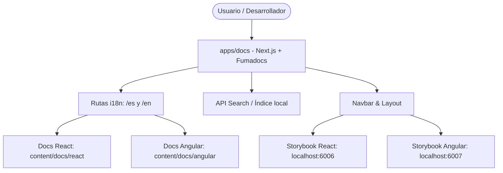

# Requirements

### Overview & Goals
El objetivo de esta tarea es establecer la infraestructura inicial de documentación para el monorepo `facil-ui`. Se configurará un portal unificado en `apps/docs` utilizando **Fumadocs** (`fumadocs-ui` y `fumadocs-core`) sobre **Next.js** y gestionado con **Bun**.

El portal ofrecerá una experiencia centralizada donde los desarrolladores podrán consultar la documentación de las librerías `@facil-ui/react` y `@facil-ui/angular`, alternar entre idiomas (Español e Inglés), buscar contenido de manera instantánea y acceder directamente a los entornos interactivos de Storybook de cada framework.

### Scope
#### In Scope
- Creación de la aplicación `apps/docs` en el espacio de trabajo de Bun.
- Integración de dependencias `fumadocs-ui`, `fumadocs-core`, `next`, `react` y `react-dom`.
- Configuración de soporte internacional (i18n) para **Español (`es`)** e **Inglés (`en`)**.
- Configuración de navegación modular dividida por framework (`React` y `Angular`).
- Implementación de motor de búsqueda local/estático provisto por Fumadocs.
- Configuración de enlaces directos a los Storybooks de React (puerto 6006) y Angular (puerto 6007).
- Creación de páginas de documentación iniciales (Introducción, Instalación y Componente de ejemplo) en MDX para ambos idiomas.
- Configuración de scripts en el `package.json` raíz (`docs:dev`, `docs:build`).

#### Out of Scope
- Documentación exhaustiva de todos los componentes futuros (solo estructura y páginas de inicio/ejemplo).
- Despliegue en producción o pipelines de CI/CD avanzados.
- Modificación del código fuente de los paquetes `@facil-ui/react` y `@facil-ui/angular`.

### User Stories
- **Como desarrollador**, quiero un portal unificado de documentación para consultar guías y componentes de `facil-ui` para React y Angular en un solo lugar.
- **Como usuario hispanohablante o angloparlante**, quiero poder cambiar el idioma de la documentación entre español e inglés para comprender mejor el uso de las librerías.
- **Como desarrollador UI**, quiero enlaces directos desde la documentación hacia los Storybooks de React y Angular para probar interactivamente los componentes.
- **Como consumidor de la librería**, quiero un buscador rápido integrado en la barra de navegación para localizar componentes y propiedades rápidamente.

### Functional Requirements
- **Rutas e i18n:** El portal debe resolver rutas bajo prefijo de idioma (p. ej. `/es/docs/react/overview` y `/en/docs/react/overview`).
- **Navegación por Framework:** La barra de navegación superior debe permitir alternar fácilmente entre la sección de **React** y la de **Angular**.
- **Búsqueda:** Integración del modal de búsqueda de Fumadocs con indexación automática del contenido MDX.
- **Enlaces a Storybook:** Enlaces visibles en la barra superior o en cada sección para abrir el Storybook correspondiente (`http://localhost:6006` para React y `http://localhost:6007` para Angular).
- **Tema:** Soporte de tema claro y oscuro (Dark / Light mode) integrado mediante Fumadocs UI.

### Non-Functional Requirements
- **Compatibilidad con Bun:** Instalación, ejecución en desarrollo y compilación 100% compatibles con el runtime y gestor de paquetes Bun.
- **Rendimiento:** Carga estática rápida basada en Server Components de Next.js App Router.
- **Mantenibilidad:** Estructura de carpetas limpia y tipada con TypeScript para que añadir nuevos documentos en MDX sea directo y sencillo.

# Technical Design

### Current Implementation
Actualmente, el proyecto es un monorepo gestionado con Bun (`workspaces: ["packages/*", "apps/*"]` en `package.json`).
- Contiene los paquetes `@facil-ui/react` (con script `storybook` en puerto 6006) y `@facil-ui/angular` (con script `storybook` en puerto 6007), además de `@facil-ui/contracts`, `@facil-ui/tokens` y `@facil-ui/utils`.
- El directorio `apps/` existe en la configuración del workspace pero aún no contiene aplicaciones de documentación.

### Key Decisions
- **Portal Unificado en `apps/docs`:** Se adopta un único portal Next.js en `apps/docs` con selector de framework e i18n para evitar duplicar configuraciones de compilación, temas y motores de búsqueda.
- **Fumadocs con App Router:** Uso de `fumadocs-ui` y `fumadocs-core` con Next.js App Router y MDX dinámico (`source.config.ts`), aprovechando la compatibilidad nativa con TypeScript y Bun.
- **Estructura de Contenido Multi-idioma:** Contenidos organizados en `content/docs/[framework]/[doc].[lang].mdx` o subdirectorios por idioma para permitir mantenimiento simétrico en español e inglés.
- **Búsqueda Estática/Local:** Implementación de búsqueda interna de Fumadocs vía Route Handler (`app/api/search/route.ts`) sin requerir servicios externos de terceros en la etapa inicial.

### Architecture Diagram


### File Structure
```
facil-ui/
├── package.json                          (actualizado: scripts docs:dev, docs:build)
├── apps/
│   └── docs/
│       ├── package.json                  (@facil-ui/docs con fumadocs-ui, fumadocs-core, next)
│       ├── next.config.mjs               (configuración de Next.js + Fumadocs MDX)
│       ├── tsconfig.json                 (paths y configuración TypeScript)
│       ├── source.config.ts              (definición de colecciones y configuración Fumadocs)
│       ├── lib/
│       │   ├── source.ts                 (loader de páginas y árbol de navegación)
│       │   └── i18n.ts                   (configuración de idiomas: es, en)
│       ├── content/
│       │   └── docs/
│       │       ├── react/
│       │       │   ├── index.mdx         (introducción en español)
│       │       │   ├── index.en.mdx      (introducción en inglés)
│       │       │   ├── button.mdx
│       │       │   └── button.en.mdx
│       │       └── angular/
│       │           ├── index.mdx         (introducción en español)
│       │           ├── index.en.mdx      (introducción en inglés)
│       │           ├── button.mdx
│       │           └── button.en.mdx
│       └── app/
│           ├── layout.tsx                (Root layout con providers de Fumadocs)
│           ├── [lang]/
│           │   ├── layout.tsx            (Layout de idioma)
│           │   ├── page.tsx              (Página principal / Landing del portal)
│           │   └── docs/
│           │       └── [[...slug]]/
│           │           └── page.tsx      (Renderizado dinámico de páginas MDX)
│           └── api/
│               └── search/
│                   └── route.ts          (Endpoint de búsqueda de Fumadocs)
```

### Data Models / Contracts & Configs

#### `apps/docs/package.json`
```json
{
  "name": "@facil-ui/docs",
  "version": "0.1.0",
  "private": true,
  "scripts": {
    "dev": "next dev",
    "build": "next build",
    "start": "next start"
  },
  "dependencies": {
    "fumadocs-core": "^15.0.0",
    "fumadocs-ui": "^15.0.0",
    "next": "^15.0.0",
    "react": "^19.0.0",
    "react-dom": "^19.0.0"
  },
  "devDependencies": {
    "@types/node": "^22.0.0",
    "@types/react": "^19.0.0",
    "@types/react-dom": "^19.0.0",
    "typescript": "^5.0.0"
  }
}
```

#### `apps/docs/lib/i18n.ts`
```typescript
import type { I18nConfig } from 'fumadocs-core/i18n';

export const i18n: I18nConfig = {
  defaultLanguage: 'es',
  languages: ['es', 'en'],
};
```

#### `apps/docs/lib/source.ts`
```typescript
import { docs } from '@/.source';
import { loader } from 'fumadocs-core/source';
import { i18n } from './i18n';

export const source = loader({
  baseUrl: '/docs',
  source: docs.toFumadocsSource(),
  i18n,
});
```

### Risks & Mitigations
- **Resolución de workspaces con Bun:** Para evitar conflictos de dependencias entre Next.js y los paquetes del monorepo, se aislarán las dependencias en `apps/docs/package.json` y se verificará el build con `bun run --filter @facil-ui/docs build`.
- **Sincronización de rutas i18n:** El fallback de idioma se configurará con `defaultLanguage: 'es'` para garantizar que rutas no traducidas redirijan de forma transparente al idioma por defecto.

# Testing

### Validation Approach
La verificación de la infraestructura de documentación se llevará a cabo mediante pruebas automatizadas de compilación, chequeo de tipos TypeScript y verificación de endpoints y rutas en desarrollo.

### Key Scenarios
- **Inicio en modo desarrollo:** Ejecución de `bun run --filter @facil-ui/docs dev` e inspección de que el servidor Next.js inicia correctamente.
- **Compilación estática / Build:** Ejecución de `bun run --filter @facil-ui/docs build` asegurando que no existan errores de tipos ni de generación MDX.
- **Navegación i18n:**
  - Acceso a `/es/docs/react` cargando contenido en español.
  - Acceso a `/en/docs/react` cargando contenido en inglés.
  - Alternar idioma mediante el selector de Fumadocs UI y verificar actualización de URL y contenido.
- **Navegación entre Frameworks:**
  - Navegar a la sección de React y verificar el árbol de componentes de React.
  - Navegar a la sección de Angular y verificar el árbol de componentes de Angular.
- **Búsqueda:** Comprobar que el endpoint `/api/search` responde adecuadamente con el índice de páginas indexadas.
- **Enlaces a Storybook:** Verificar que los enlaces externos en la barra de navegación apunten a los puertos correctos (6006 para React y 6007 para Angular).

### Edge Cases
- Acceso a slugs inexistentes: Verificar que retorne una página 404 personalizada con layout consistente.
- Página MDX sin versión en inglés: Comprobar que el sistema mantenga navegación accesible o use fallback adecuado.

# Delivery Steps

### ✓ Step 1: Inicialización de apps/docs con Next.js, Fumadocs y Bun
La aplicación `apps/docs` está inicializada dentro del monorepo con Next.js, TypeScript y las dependencias de Fumadocs listas para ejecutarse con Bun.

- Crear el directorio `apps/docs` e inicializar su `package.json` con nombre `@facil-ui/docs` y dependencias base (`next`, `react`, `react-dom`, `fumadocs-ui`, `fumadocs-core`).
- Configurar `next.config.mjs` con el plugin `createMDX` de Fumadocs.
- Configurar `tsconfig.json` con paths y soporte para Next.js App Router.
- Configurar los estilos base con CSS/Tailwind según los requerimientos de tema y componentes de `fumadocs-ui`.

### ✓ Step 2: Configuración de Fumadocs Source, i18n y Búsqueda
El sistema de contenidos MDX con soporte multi-idioma (es/en) y el motor de búsqueda interno quedan plenamente operativos en el App Router.

- Definir la configuración de colecciones de contenido en `source.config.ts` o `lib/source.ts` utilizando las utilidades de `fumadocs-core` e i18n (`defineDocs`, `defineCollections`).
- Configurar el middleware o resolución de rutas i18n para soportar prefijos de idioma (`/es` y `/en`).
- Implementar la estructura de rutas dinámicas `app/[lang]/docs/[[...slug]]/page.tsx` para renderizar el contenido MDX con componentes de Fumadocs.
- Configurar el endpoint de API / proveedor de búsqueda estática local de Fumadocs (`app/api/search/route.ts`).

### ✓ Step 3: Diseño del Portal, Navegación de Frameworks y Enlaces a Storybooks
El portal cuenta con un layout responsivo, barra de navegación, switcher de idiomas, selector de frameworks y enlaces a Storybook.

- Crear el `RootLayout` en `app/[lang]/layout.tsx` integrando el `RootProvider` de Fumadocs con soporte de tema claro/oscuro e i18n.
- Configurar el layout de documentación (`DocsLayout`) con barra lateral, árbol de páginas y menú superior.
- Añadir en el header del portal la navegación entre librerías (`React` y `Angular`) y enlaces externos a los Storybooks locales (`http://localhost:6006` para React y `http://localhost:6007` para Angular).
- Integrar la barra de búsqueda y selector interactivo de idioma (`Español` / `English`).

### ✓ Step 4: Contenidos Iniciales MDX y Scripts del Monorepo
La documentación base en MDX para ambos frameworks está creada en español e inglés y los comandos de ejecución están integrados en el monorepo.

- Crear la estructura de carpetas de contenido bajo `content/docs/react` y `content/docs/angular` para idiomas `es` y `en`.
- Redactar páginas iniciales de introducción y guía de instalación para `@facil-ui/react` y `@facil-ui/angular`.
- Añadir una página de ejemplo de componente base (p. ej., `Button`) con ejemplos de uso en ambos frameworks y enlaces directos a sus historias en Storybook.
- Registrar los scripts `docs:dev` y `docs:build` en el `package.json` raíz del monorepo para ejecutar el portal mediante `bun`.