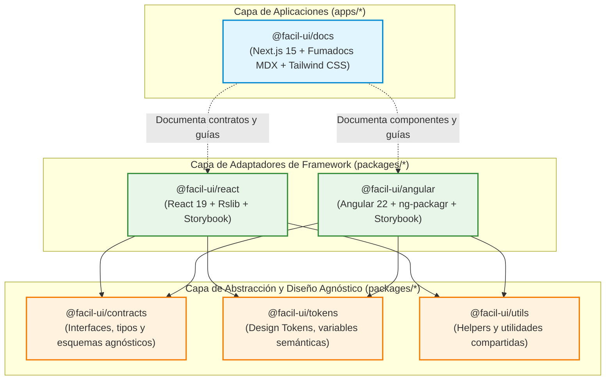

# 01 - Architecture Overview (Visión General de la Arquitectura)

## 1. Descripción General

`facil-ui` es un monorepo orientado al desarrollo de una librería agnóstica de componentes de interfaz de usuario (UI), diseñada para abastecer aplicaciones tanto en el ecosistema **React** como en **Angular**, centralizando la documentación en un portal web interactivo bilingüe y facilitando entornos de desarrollo visual independientes a través de **Storybook**.

El proyecto busca maximizar la utilidad y la eficiencia en el ciclo de vida del desarrollo frontend empresarial, reduciendo la redundancia de código, unificando contratos de diseño y desacoplando la lógica de componentes del framework receptor.

---

## 2. Objetivos del Sistema

1. **Eficiencia en el Reúso Multi-Framework**: Permitir que equipos de desarrollo que utilizan React 19+ o Angular 22+ compartan contratos, tokens de diseño y utilidades idénticas sin duplicar el esfuerzo de diseño ni de lógica base.
2. **Desarrollo Aislado y Validación Continua**: Proporcionar entornos interactivos dedicados mediante Storybook para la validación visual y funcional atómica de cada componente en ambos ecosistemas.
3. **Consumo y Documentación Centralizada**: Ofrecer un portal de documentación estático y reactivo impulsado por Next.js y Fumadocs con soporte bilingüe (español e inglés) y búsqueda en tiempo real.
4. **Optimización de Recursos y Velocidad de Build**: Centralizar la gestión del espacio de trabajo con el runtime Bun y empaquetadores modernos (Rslib/Rsbuild para React, ng-packagr para Angular).

---

## 3. Arquitectura de Alto Nivel

El sistema implementa una arquitectura basada en **Monorepo por Capas de Responsabilidad** gestionado mediante los workspaces de Bun (`packages/*` y `apps/*`).

---

## 4. Componentes Principales y Responsabilidades

| Componente / Módulo | Tipo | Ruta | Responsabilidad Principal |
| :--- | :--- | :--- | :--- |
| **Workspace Root** | Orquestador | `/` | Gestión de dependencias globales, scripts de coordinación de ciclo de vida (`build`, `typecheck`, `docs:*`) y configuración compartida de TypeScript. |
| **@facil-ui/react** | Paquete (Lib) | `packages/react` | Implementación de componentes UI nativos para React 19+. Empaquetado ESM con Rslib y catálogo interactivo en Storybook (puerto 6006). |
| **@facil-ui/angular** | Paquete (Lib) | `packages/angular` | Implementación de componentes UI nativos standalone para Angular 22+. Empaquetado con `ng-packagr` y catálogo interactivo en Storybook (puerto 6007). |
| **@facil-ui/contracts** | Paquete (Core) | `packages/contracts` | Definición de interfaces TypeScript, contratos de propiedades (props/inputs) y tipos estandarizados compartidos entre frameworks. |
| **@facil-ui/tokens** | Paquete (Core) | `packages/tokens` | Definición de tokens de diseño atómicos (colores, tipografía, espaciados, bordes, estados de interacción). |
| **@facil-ui/utils** | Paquete (Core) | `packages/utils` | Funciones auxiliares y utilidades de renderizado/atributos compartidas entre implementaciones. |
| **@facil-ui/docs** | Aplicación Web | `apps/docs` | Portal de documentación estático generado mediante Next.js 15 App Router y Fumadocs, con internacionalización y motor de búsqueda de contenidos. |

---

## 5. Decisiones Arquitectónicas Observadas vs. Estado Actual

### Hechos Comprobados en el Código
- **Workspace Monorepo**: Orquestado por Bun (`package.json` declara `"workspaces": ["packages/*", "apps/*"]`).
- **Framework Adapters Específicos**: Separación explícita de implementaciones nativas (`@facil-ui/react` y `@facil-ui/angular`), manteniendo dependencias de framework como `peerDependencies`.
- **Ecosistema de Documentación y Visualización Desacoplado**: Se definen instancias independientes de Storybook para cada framework (puertos 6006 y 6007) y un portal centralizador de guías en `apps/docs`.

### Inferencias Arquitectónicas
- El diseño persigue un modelo de **Componentes Controlados por Atributos de Datos (`data-variant`, `data-*`)** donde el estilado global o por tokens controla la apariencia sin acoplarse estrechamente a motores CSS propietarios dentro de los componentes.
- Los paquetes `contracts`, `tokens` y `utils` fueron proyectados como la fuente única de verdad para evitar divergencias entre React y Angular.

### Recomendaciones de Mejora Arquitectónica
- Completar la materialización de los paquetes de la capa central (`contracts`, `tokens`, `utils`), los cuales en el estado actual carecen de puntos de entrada `src/index.ts`.
- Resolver la alineación de exportación pública en `@facil-ui/angular/src/index.ts` para que exponga formalmente `ButtonComponent`.
- Corregir las dependencias de empaquetado en Angular para que `@angular/platform-browser` no genere conflictos de compilación en `ng-packagr`.
