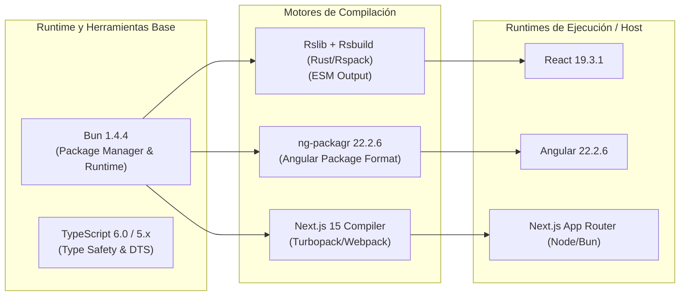

# 02 - Technical Stack (Pila Tecnológica)

## 1. Resumen de Tecnologías y Versiones

La selección tecnológica del repositorio busca maximizar la velocidad de compilación, reducir los tiempos de retroalimentación en desarrollo local y garantizar la interoperabilidad de componentes en aplicaciones modernas.

| Categoría | Tecnología / Herramienta | Versión Declarada / Bloqueada | Ámbito / Módulo | Justificación Técnica Comprobada / Observable |
| :--- | :--- | :--- | :--- | :--- |
| **Runtime & Package Manager** | **Bun** | `v1.4.4` (lockfile v0) | Monorepo global | Rendimiento de E/S ultrarrápido, resolución nativa de workspaces y ejecución de TypeScript sin transpilation step previo en scripts auxiliares. |
| **Lenguaje Primario** | **TypeScript** | `~6.0.0` (Root) / `5.x` | Global | Tipado estático estricto (`strict: true`), validación de contratos entre paquetes y generación de archivos `.d.ts`. |
| **Framework UI (Web)** | **React** | `^19.3.1` (peer) / `^19.0.0` | `packages/react`, `apps/docs` | Ecosistema de componentes estándar con soporte de React Server Components y React 19 Actions/Hooks. |
| **Framework UI (Web)** | **Angular** | `22.2.6` | `packages/angular` | Framework modular empresarial con arquitectura standalone components (`standalone: true`) y Signals de Angular (`input()`). |
| **Framework de Documentación**| **Next.js** | `^15.0.0` | `apps/docs` | App Router, Server Components y generación de páginas estáticas (SSG) de alto rendimiento. |
| **Motor de Documentación MDX** | **Fumadocs** (`ui`, `core`, `mdx`)| `^15.0.0` / `^11.0.0` | `apps/docs` | Renderizado avanzado de MDX, soporte de internacionalización integrada y API de búsqueda estática. |
| **Estilado & UI** | **Tailwind CSS** + PostCSS | `^4.3.5` / `^8.4.49` | `apps/docs` | Utilidades CSS de compilación rápida para la capa visual del portal de documentación. |
| **Empaquetador de Librería React**| **Rslib** (`@rslib/core`) + Rsbuild | `^1.0.7` / `^2.1.1` | `packages/react` | Empaquetador basado en Rust (Rspack) que optimiza los tiempos de build ESM y generación de DTS. |
| **Empaquetador de Librería Angular**| **ng-packagr** | `22.2.6` | `packages/angular` | Herramienta canónica del ecosistema Angular para generar paquetes en formato Angular Package Format (APF) y bundles FESM. |
| **Entorno de Aislamiento Visual**| **Storybook** (`react-vite` & `angular-vite`)| `^10.6.0` | `packages/react`, `packages/angular` | Desarrollo, prueba y documentación visual de componentes aislados de la lógica de aplicación host. |
| **Manejo de Reactividad** | **RxJS** | `^7.8.2` | `packages/angular` | Gestión de flujos asíncronos y reactividad en Angular. |

---

## 2. Análisis por Capa Tecnológica

---

## 3. Justificación Técnica de Decisiones Clave

1. **Adopción de Rslib para `@facil-ui/react`**:
   - *Hecho comprobado*: El archivo `packages/react/rslib.config.ts` configura salida ESM con `syntax: 'es2022'` y `dts: true`. La compilación toma ~0.08s produciendo `dist/index.js` (0.25 kB).
   - *Justificación*: Rslib aprovecha Rspack para tiempos de compilación casi instantáneos sin requerir la sobrecarga de Webpack.

2. **Adopción de Standalone Components y Signals en `@facil-ui/angular`**:
   - *Hecho comprobado*: En `packages/angular/src/lib/button/button.component.ts`, el componente usa `@Component({ standalone: true })` e `input()` de `@angular/core`.
   - *Justificación*: Elimina la necesidad de `NgModules` boilerplate, reduciendo el bundle size y mejorando la ergonomía de consumo en Angular moderno.

3. **Portal con Fumadocs sobre Next.js 15**:
   - *Hecho comprobado*: `apps/docs/app/[lang]/docs/[[...slug]]/page.tsx` utiliza SSG (`generateStaticParams`) y el loader de `fumadocs-core` con internacionalización nativa.
   - *Justificación*: Genera 16 rutas estáticas pre-renderizadas optimizando la entrega en CDN con un costo computacional mínimo en runtime.
