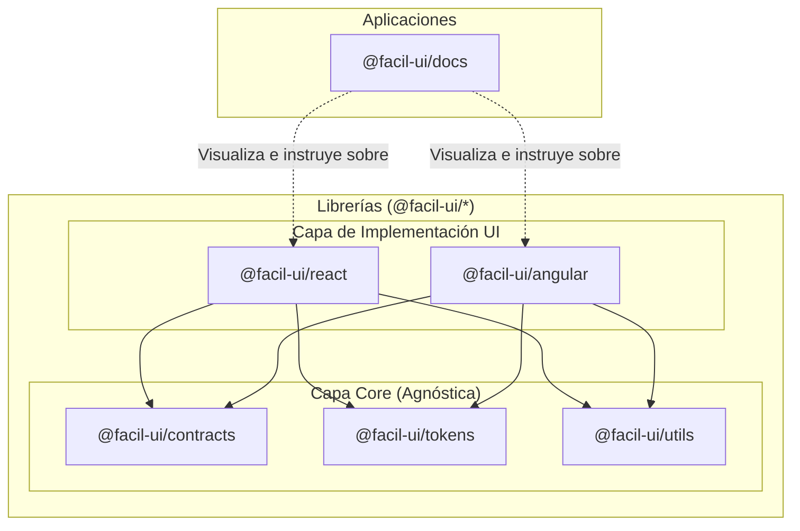

# 04 - Modules & Components (Módulos y Componentes)

## 1. Módulos del Sistema

El monorepo está dividido funcionalmente en módulos que operan como librerías de componentes y aplicaciones consumidoras:



---

## 2. Detalle de Componentes y Contratos Existentes

### 2.1 Componente `Button` en `@facil-ui/react`

- **Ubicación**: `packages/react/src/index.tsx`
- **Punto de Entrada**: `packages/react/src/index.tsx`
- **Patrón**: Functional Component con extensión de atributos nativos de HTML.

#### Contrato TypeScript
```typescript
import type { ButtonHTMLAttributes } from 'react';

export interface ButtonProps extends ButtonHTMLAttributes<HTMLButtonElement> {
    variant?: 'primary' | 'secondary';
}

export function Button({
    variant = 'primary',
    children,
    ...props
}: ButtonProps): JSX.Element;
```

#### Mecanismo de Renderizado
El componente delega el renderizado al elemento nativo `<button>` inyectando el atributo `data-variant={variant}`:
```tsx
<button data-variant={variant} {...props}>
    {children}
</button>
```

#### Historias en Storybook
- **Ubicación**: `packages/react/stories/Button.stories.tsx`
- **Variantes cubiertas**: `Primary` (`variant: 'primary'`), `Secondary` (`variant: 'secondary'`).

---

### 2.2 Componente `ButtonComponent` en `@facil-ui/angular`

- **Ubicación**: `packages/angular/src/lib/button/button.component.ts`
- **Punto de Entrada Declarado**: `packages/angular/src/index.ts`
- **Patrón**: Standalone Component con Angular Signals (`input()`).

#### Contrato y Definición Angular
```typescript
import { Component, input } from '@angular/core';

@Component({
    selector: 'facil-button',
    standalone: true,
    template: `
    <button
      type="button"
      [attr.data-variant]="variant()"
      [disabled]="disabled()"
    >
      <ng-content />
    </button>
  `,
})
export class ButtonComponent {
    variant = input<'primary' | 'secondary'>('primary');
    disabled = input(false);
}
```

#### Historias en Storybook
- **Ubicación**: `packages/angular/stories/button.stories.ts`
- **Variantes cubiertas**: `Primary` (`variant: 'primary'`, `disabled: false`), `Secondary` (`variant: 'secondary'`, `disabled: false`), `Disabled` (`variant: 'primary'`, `disabled: true`).

---

## 3. Estado de la Capa Core Compartida

Los paquetes `@facil-ui/contracts`, `@facil-ui/tokens` y `@facil-ui/utils` se encuentran definidos en el workspace para centralizar los tipos base, paletas de tokens y utilidades. 

| Módulo | Declaración de Export | Estado de Archivos en Disco | Dependencia en React | Dependencia en Angular |
| :--- | :--- | :--- | :--- | :--- |
| `@facil-ui/contracts` | `"exports": { ".": "./src/index.ts" }` | Solo `package.json` presente | Declarado en `dependencies` | Declarado en `dependencies` |
| `@facil-ui/tokens` | `"exports": { ".": "./src/index.ts" }` | Solo `package.json` presente | Declarado en `dependencies` | Declarado en `dependencies` |
| `@facil-ui/utils` | `"exports": { ".": "./src/index.ts" }` | Solo `package.json` presente | Declarado en `dependencies` | Declarado en `dependencies` |

---

## 4. Comunicación y Acoplamiento entre Componentes

1. **Desacoplamiento Estilístico**: Ninguno de los componentes React o Angular incluye hojas de estilo CSS o SCSS acopladas directamente en su definición. Utilizan el atributo HTML `data-variant` como selector para que los estilos globales o los temas del consumidor controlen la apariencia visual.
2. **Compatibilidad con Ranuras Nativas (Slots/Projections)**:
   - React utiliza `{children}` para composición libre.
   - Angular utiliza `<ng-content />` para proyección de contenido nativa.
3. **Manejo de Eventos**:
   - En React, se propagan todos los listeners nativos a través de `...props` (`onClick`, `onFocus`, etc.).
   - En Angular, el selector `facil-button` proyecta un elemento `<button type="button">` interno. Los consumidores deben interactuar a través de las entradas/salidas expuestas o listeners del host.
