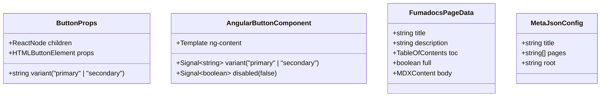
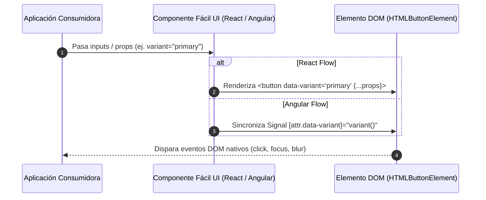

# 05 - Data Architecture (Arquitectura de Datos)

## 1. Naturaleza de los Datos y Persistencia

Como librería de componentes de interfaz de usuario frontend y portal de documentación, el repositorio `facil-ui` **no cuenta con bases de datos relacionales, ORMs, esquemas SQL ni motores de persistencia en disco**.

La arquitectura de datos se estructura en torno a tres formas de representación de información:
1. **Modelos de Tipos y Propiedades de Componentes** (en memoria / compile-time).
2. **Estructuras de Contenido y Metadatos MDX** (archivos estáticos serializados en JSON/MDX).
3. **Flujos de Reactividad y Estado Local** (React Props y Angular Signals).

---

## 2. Modelos y Entidades

### 2.1 Modelos de Componentes UI



---

## 3. Modelo de Contenidos del Portal de Documentación (Fumadocs)

Los datos del portal `apps/docs` provienen de archivos estáticos organizados por idioma y framework:

### Estructura de Metadatos de Navegación (`meta.json` / `meta.en.json`)
```json
{
  "title": "React",
  "pages": [
    "index",
    "installation",
    "--- Componentes ---",
    "button"
  ]
}
```

### Esquema de Colecciones (`apps/docs/source.config.ts`)
```typescript
import { defineDocs, defineConfig } from 'fumadocs-mdx/config';

export const { docs, meta } = defineDocs({
  dir: 'content/docs',
});

export default defineConfig();
```

---

## 4. Flujo de Datos



1. **Flujo Unidireccional**: Los datos fluyen desde la aplicación anfitriona hacia los componentes UI mediante propiedades (React) o Signals (Angular).
2. **Propagación Semántica**: Los estados (`disabled`, `variant`) se reflejan en el DOM a través de atributos HTML estándar (`[disabled]`) y atributos de datos (`[attr.data-variant]`), permitiendo que el motor CSS externo aplique las reglas visuales correspondientes.
3. **Indexación Estática**: Durante el proceso de build de `apps/docs`, el compilador de Fumadocs transforma los archivos MDX en metadatos indexados accesibles para el Route Handler de búsqueda (`/api/search`).
