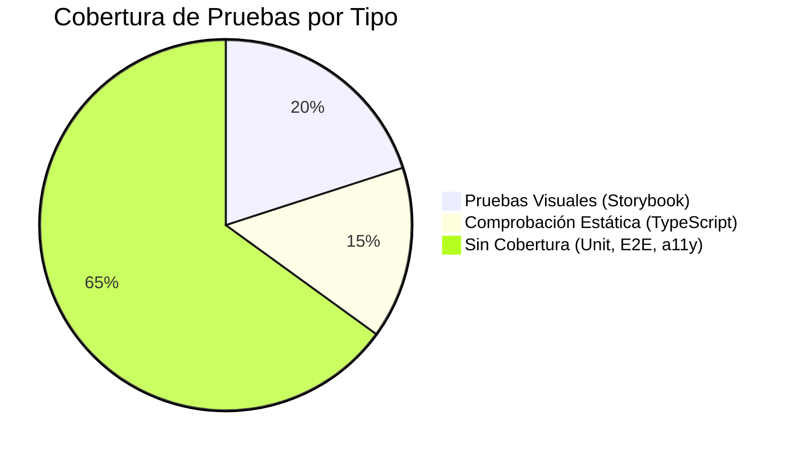
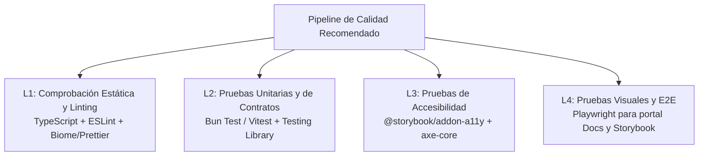

# 08 - Testing Strategy (Estrategia de Pruebas y Calidad)

## 1. Estado Actual de la Estrategia de Calidad

| Dimensión de Calidad | Herramienta / Mecanismo | Estado de Implementación | Observación Comprobada |
| :--- | :--- | :--- | :--- |
| **Pruebas Unitarias** | Ninguno (e.g. Bun Test, Vitest, Jest) | ❌ Inexistente | No se han configurado runners de pruebas unitarias ni scripts `"test"` en ningún `package.json`. |
| **Pruebas de Componentes Visuales**| **Storybook** (`@storybook/addon-docs`)| ⚠️ Parcial / En Proceso | Se implementan historias interactivas para el componente `Button` en React (`Button.stories.tsx`) y Angular (`button.stories.ts`). |
| **Verificación de Tipos Estáticos** | **TypeScript Compiler** (`tsc` / `bun check`)| ⚠️ Parcial | Script `"typecheck"` declarado en la raíz y en `@facil-ui/react`. Presenta fallos por resolución de módulos dinámicos y dependencias cruzadas. |
| **Pruebas de Accesibilidad (a11y)** | Ninguno (e.g. `@storybook/addon-a11y`, `axe-core`) | ❌ Inexistente | A pesar de que la documentación promueve accesibilidad WCAG/WAI-ARIA, no hay aserciones automáticas en el pipeline. |
| **Pruebas de Integración y E2E** | Ninguno (e.g. Playwright, Cypress) | ❌ Inexistente | Sin cobertura E2E para el portal de documentación `apps/docs`. |

---

## 2. Organización y Cobertura Existente

### 2.1 Cobertura de Componentes en Storybook
- **React**:
  - `Button` (`packages/react/stories/Button.stories.tsx`): Historias para variantes `Primary` y `Secondary`.
- **Angular**:
  - `ButtonComponent` (`packages/angular/stories/button.stories.ts`): Historias para `Primary`, `Secondary` y `Disabled`.

---

## 3. Áreas Críticas sin Cobertura Identificadas

1. **Pruebas Unitarias de Renderizado y Eventos**:
   - Falta de pruebas sobre el paso de propiedades, propagación de eventos (`onClick`), atributos ARIA (`aria-disabled`) y renderizado condicional de slots (`ng-content` / `children`).
2. **Pruebas de Regresión Visual (VRT)**:
   - Los Storybooks operan solo como entornos de visualización manual; no existe integración con Chromatic o Playwright Screenshots para prevenir roturas visuales.
3. **Pruebas de Contratos entre Paquetes**:
   - Inexistencia de suites de pruebas que validen que `@facil-ui/react` y `@facil-ui/angular` respeten estrictamente las especificaciones de `@facil-ui/contracts`.

---

## 4. Estrategia y Recomendaciones de Calidad

Para maximizar el retorno de inversión y mitigar riesgos en entornos de producción, se recomienda:

1. **Configurar `bun test` o `vitest`**:
   - Añadir script raíz `"test": "bun test"` para ejecutar aserciones unitarias en milisegundos sin sobrecarga de empaquetado.
2. **Integrar `@storybook/addon-a11y`**:
   - Añadir el plugin de accesibilidad en `.storybook/main.ts` de ambos paquetes para auditar contraste y atributos ARIA de forma interactiva.
3. **Automatizar el Typechecking en CI**:
   - Corregir el script de validación para ejecutar el build de Fumadocs previo a la comprobación de tipos.
