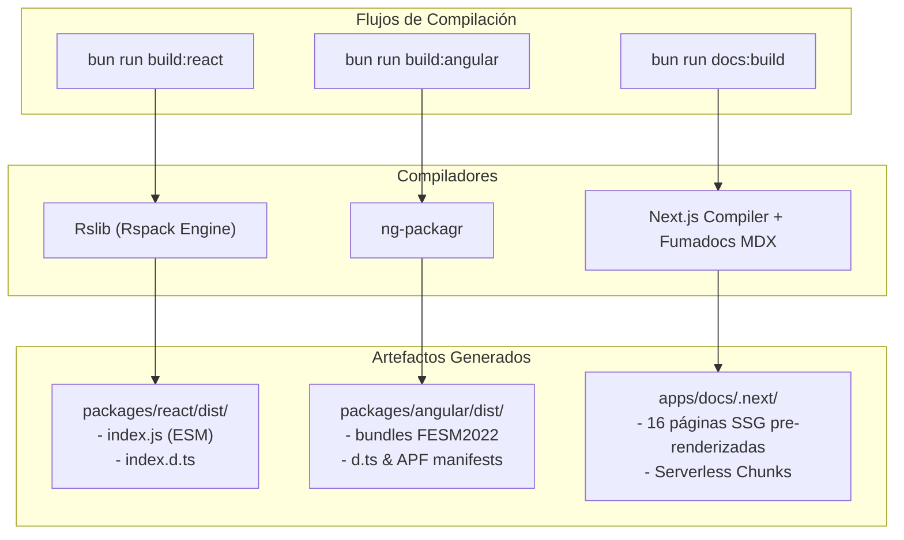
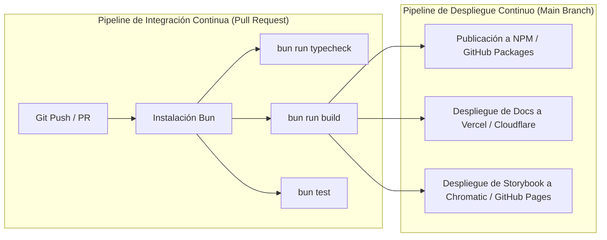

# 09 - Deployment & DevOps (Despliegue y Operaciones)

## 1. Pipeline de Compilación y Artefactos

El monorepo cuenta con flujos de compilación diferenciados según la naturaleza del artefacto (librería para distribución vs. aplicación web desplegable):



---

## 2. Infraestructura y Docker

- **Estado Comprobado**: En el estado actual del repositorio **no existen archivos `Dockerfile`, `docker-compose.yml` ni manifiestos de Kubernetes**.
- **Infraestructura Identificada**:
  - El desarrollo se ejecuta directamente sobre el host mediante el runtime Bun.
  - La aplicación de documentación (`apps/docs`) está basada en Next.js 15, permitiendo despliegues nativos estáticos (`output: 'export'`) o serverless en plataformas como Vercel, Netlify o Cloudflare Pages.

---

## 3. Integración y Entrega Continua (CI/CD)

- **Estado Comprobado**: **No existen pipelines automatizados de CI/CD** (e.g. directorios `.github/workflows`, `.gitlab-ci.yml`, `azure-pipelines.yml`).
- **Riesgo Operativo**: La integración de cambios depende exclusivamente de la disciplina manual del desarrollador en su entorno local, lo que eleva el riesgo de integrar regresiones o builds rotos.

---

## 4. Estrategia Recomendada de CI/CD y Despliegue

Para optimizar la fiabilidad y automatizar la entrega de valor, se recomienda la implementación del siguiente flujo:



### Configuración de Referencia para GitHub Actions (`.github/workflows/ci.yml`)
```yaml
name: CI Pipeline

on:
  push:
    branches: [main]
  pull_request:
    branches: [main]

jobs:
  validate:
    runs-on: ubuntu-latest
    steps:
      - uses: actions/checkout@v4
      - uses: oven-sh/setup-bun@v2
        with:
          bun-version: latest
      - name: Install dependencies
        run: bun install --frozen-lockfile
      - name: Build libraries and docs
        run: bun run build && bun run docs:build
```
