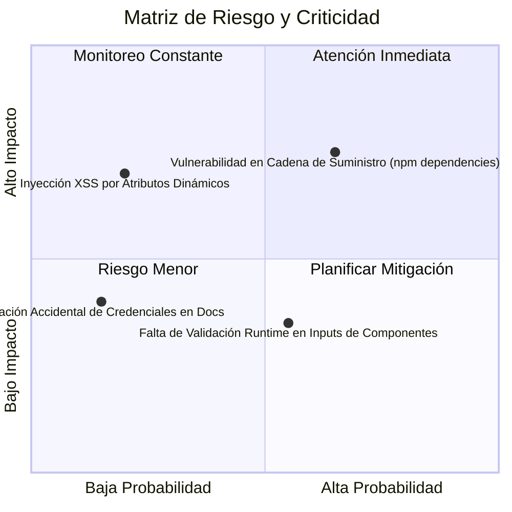

# 10 - Security Review (Revisión de Seguridad)

## 1. Postura de Seguridad y Mecanismos Existentes

Como repositorio de componentes de interfaz de usuario y documentación estática, la superficie de ataque es reducida en comparación con aplicaciones backend de procesamiento de transacciones. No obstante, la integridad de los paquetes distribuidos es crítica para evitar vectores de ataque a las aplicaciones consumidoras.

| Mecanismo de Seguridad | Estado | Evaluación Técnica |
| :--- | :--- | :--- |
| **Gestión de Secretos y Credenciales**| ✅ Seguro | No se identificaron claves API, tokens, contraseñas ni archivos `.env` comprometidos en el repositorio. |
| **Prevención de XSS (Cross-Site Scripting)**| ✅ Seguro | React 19 y Angular 22 escapan valores dinámicos y proyecciones de plantillas de forma nativa. No se detectó uso de `dangerouslySetInnerHTML` ni `bypassSecurityTrust*`. |
| **Control de Integridad de Dependencias** | ⚠️ Aceptable | Existe un archivo `bun.lock` que asegura la reproducibilidad de los paquetes instalados. Falta auditoría automática de vulnerabilidades en CI. |
| **Validación de Entradas (Inputs/Props)** | ⚠️ Parcial | La validación ocurre a nivel estático con TypeScript (`variant: 'primary' | 'secondary'`), pero no en tiempo de ejecución (runtime prop validation). |
| **Autenticación y Autorización** | ℹ️ N/A | No aplica en librerías de UI desacopladas ni en el portal de documentación estático. |

---

## 2. Matriz de Riesgos Identificados

---

## 3. Riesgos Técnicos Detectados

1. **Vulnerabilidades en Dependencias de Terceros (Supply Chain Risk)**:
   - *Riesgo*: Dependencias transitivas en paquetes de Storybook (`10.6.0`), Angular (`22.2.6`) y Next.js (`15.0.0`) pueden contener vulnerabilidades conocidas (CVEs).
   - *Impacto*: Alto si se distribuye código contaminado a aplicaciones cliente.
2. **Propagación Irrestricta de Atributos (`...props`) en React**:
   - *Hecho comprobado*: En `packages/react/src/index.tsx`, `<button data-variant={variant} {...props}>` propaga cualquier atributo arbitrario que el consumidor provea.
   - *Riesgo*: Si el consumidor inyecta atributos no sanitizados procedentes de fuentes no confiables, podría alterar el comportamiento semántico del DOM.

---

## 4. Recomendaciones de Seguridad Priorizadas

| Prioridad | Recomendación | Acción Concreta |
| :--- | :--- | :--- |
| **HIGH** | Automatizar Auditoría de Dependencias | Integrar un paso de `bun audit` o `npm audit` en el pipeline de CI para bloquear dependencias con CVEs críticos. |
| **MEDIUM** | Implementar `dependabot` / `renovate` | Configurar actualizaciones automáticas de parches de seguridad para dependencias clave. |
| **MEDIUM** | Sanitización y Validación de Tipos | Asegurar que `data-variant` solo acepte valores estrictamente permitidos en runtime si se utilizan en contextos no tipados. |
| **LOW** | Políticas de Publicación Segura (Provenance) | Habilitar firmas de procedencia criptográfica (npm provenance) cuando se configuren publicaciones automatizadas en npm. |
