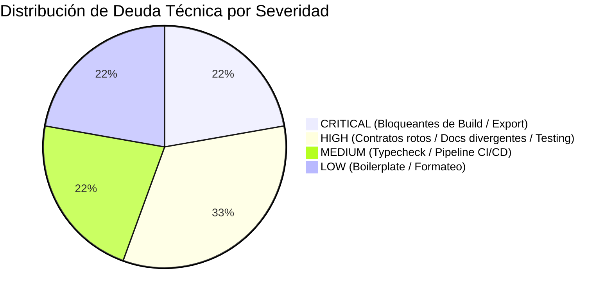

# 11 - Technical Debt & Recommendations (Deuda Técnica y Recomendaciones)

## 1. Resumen de Hallazgos y Deuda Técnica

Durante la auditoría técnica exhaustiva del código fuente y configuraciones del repositorio `facil-ui`, se han identificado discrepancias e inconsistencias que impactan la utilidad, mantenibilidad y estabilidad del sistema.



---

## 2. Inventario Detallado de Problemas Técnicos

### 2.1 Bloqueo en Compilación de Angular (CRITICAL)
- **Hecho Comprobado**: Al ejecutar `bun run build:angular`, `ng-packagr` aborta con el error: `Dependency @angular/platform-browser must be explicitly allowed using the "allowedNonPeerDependencies" option`.
- **Causa Raíz**: `@angular/platform-browser` está listado en `dependencies` dentro de `packages/angular/package.json`, pero no está incluido en `allowedNonPeerDependencies` dentro de `packages/angular/ng-package.json` ni movido a `peerDependencies`.

### 2.2 API Pública Incompleta en `@facil-ui/angular` (CRITICAL)
- **Hecho Comprobado**: `packages/angular/src/index.ts` únicamente contiene:
  ```typescript
  // API pública de FACIL UI Angular.
  // Aquí exportaremos los componentes, directivas y servicios.
  export {};
  ```
- **Impacto**: `ButtonComponent` no se expone a los consumidores de la librería.

### 2.3 Paquetes Agnósticos Centrales Vacíos (HIGH)
- **Hecho Comprobado**: `@facil-ui/contracts`, `@facil-ui/tokens` y `@facil-ui/utils` son declarados como dependencias en `packages/react` y `packages/angular`, y sus `package.json` apuntan a `"./src/index.ts"`. Sin embargo, no existen archivos de código dentro de esos tres directorios.

### 2.4 Divergencia entre Documentación MDX y Código Real (HIGH)
- **Hecho Comprobado**:
  - En `apps/docs/content/docs/react/button.mdx` y `angular/button.mdx` se documentan variantes `outline`, `ghost` y tamaños `size="sm"|"md"|"lg"`. En el código fuente real (`index.tsx` y `button.component.ts`), `variant` solo admite `'primary' | 'secondary'` y la propiedad `size` no existe.
  - La documentación de Angular sugiere `import { FacilButtonComponent } from '@facil-ui/angular'`, cuando el identificador en el código es `ButtonComponent`.

### 2.5 Ausencia de Pruebas Automatizadas (HIGH)
- **Hecho Comprobado**: No existen suites de pruebas unitarias (`.spec.ts` o `.test.tsx`), ni runners de pruebas configurados en `package.json`.

### 2.6 Errores de Typecheck en el Workspace (MEDIUM)
- **Hecho Comprobado**: `bun check` reporta 10 errores de resolución de tipos debido a que los tipos de `@/.source` se generan en tiempo de build de Fumadocs y existen tipos implícitos `any` en `apps/docs/lib/source.ts` y `packages/angular/stories/button.stories.ts`.

---

## 3. Matriz de Recomendaciones y Plan de Acción Priorizado

| Prioridad | ID | Hallazgo / Problema | Recomendación Técnica de Solución | Beneficio Operativo |
| :--- | :--- | :--- | :--- | :--- |
| **CRITICAL** | **REC-01** | Build roto en `@facil-ui/angular` | Añadir `@angular/platform-browser` a `allowedNonPeerDependencies` en `ng-package.json` o moverlo a `peerDependencies`. | Habilita la compilación exitosa del paquete Angular para distribución. |
| **CRITICAL** | **REC-02** | Export ausente en Angular `index.ts` | Exportar `ButtonComponent` desde `packages/angular/src/index.ts` (`export * from './lib/button/button.component';`). | Permite el consumo de los componentes Angular por aplicaciones anfitrionas. |
| **HIGH** | **REC-03** | Módulos agnósticos no implementados | Crear `src/index.ts` en `contracts`, `tokens` y `utils` y definir tipos comunes (`ButtonVariant`, `ButtonSize`, design tokens). | Evita duplicación de tipos y unifica el contrato entre React y Angular. |
| **HIGH** | **REC-04** | Desincronización en Documentación MDX | Actualizar la documentación MDX para reflejar exactamente la API actual, o implementar las variantes `outline`, `ghost` y tamaños en los componentes. | Elimina la frustración de los desarrolladores al consumir APIs inexistentes. |
| **HIGH** | **REC-05** | Falta de testing automatizado | Implementar `bun:test` o `vitest` con suites unitarias y de accesibilidad para `Button`. | Garantiza la estabilidad ante refactorizaciones y previene regresiones. |
| **MEDIUM** | **REC-06** | Fallos de resolución en `bun check` | Tipar explícitamente parámetros en `source.ts` y stories, y precompilar `.source/` en un script previo a `typecheck`. | Permite comprobación estática limpia en pre-commit y CI. |
| **MEDIUM** | **REC-07** | Ausencia de CI/CD | Crear pipeline en GitHub Actions para validar `typecheck`, `build` y `test` en cada PR. | Protege la rama principal contra roturas silenciosas. |
| **LOW** | **REC-08** | Archivo `index.ts` residual en la raíz | Eliminar o convertir `index.ts` en un script de orquestación útil para el workspace. | Limpieza de artefactos residuales de inicialización. |
